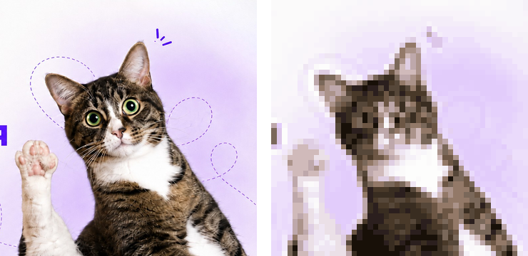
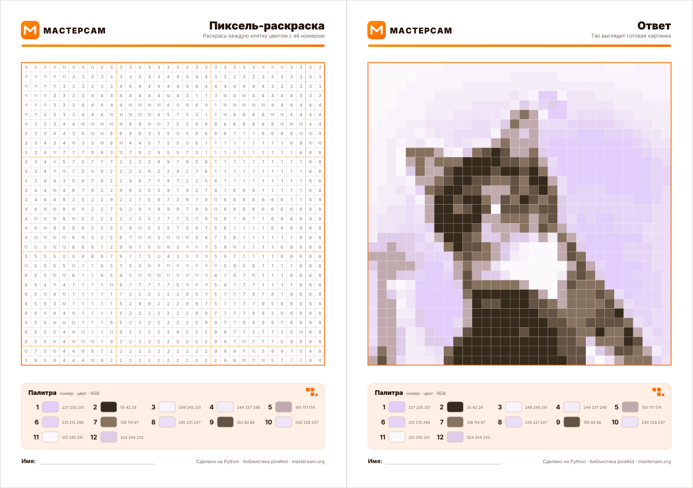
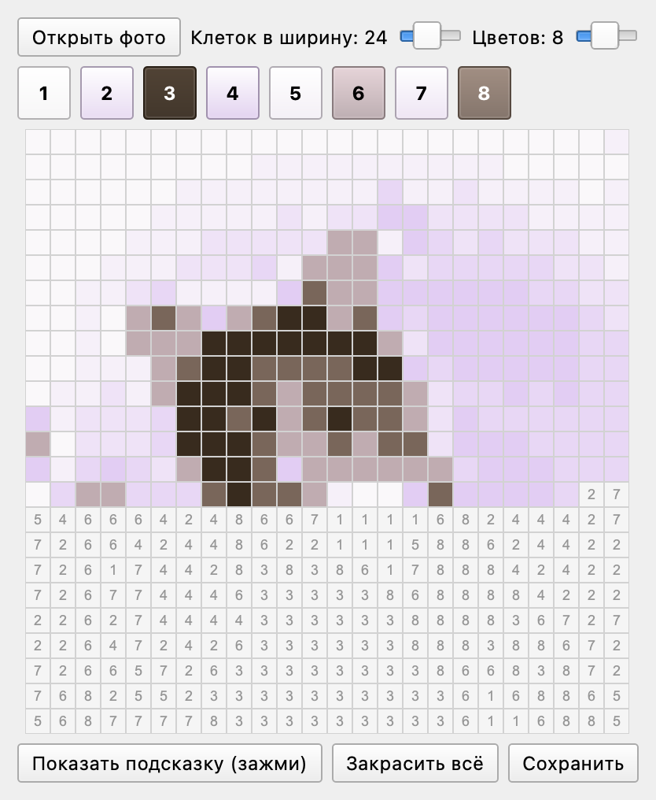

# Мастер-класс «Пиксель-арт из твоего фото»

Материалы мастер-класса по Python для детей 11–17 лет: как устроены картинки (пиксели, разрешение, RGB, соотношение сторон, форматы) и как превратить фото в пиксель-арт и PDF-раскраску по номерам.



## Что внутри

| Что | Где |
|---|---|
| Библиотека `pixelkid` ([PyPI](https://pypi.org/project/pixelkid/)) | [pixelkid/](pixelkid/README.md) |
| Скрипт для детей | [main.py](main.py) |
| Приложение «Пиксель-раскраска» (PyQt6) | [app/pixel_paint.py](app/pixel_paint.py) |
| Презентация (стиль ШЦТ) | [slides/presentation_shct.pdf](slides/presentation_shct.pdf) |
| Презентация (стиль МАСТЕРСАМ) | [slides/presentation_mastersam.pdf](slides/presentation_mastersam.pdf) |
| Конспект для преподавателя | [docs/lesson_plan.md](docs/lesson_plan.md) ([PDF](docs/lesson_plan.pdf)) |
| Документация | [docs/DOCUMENTATION.md](docs/DOCUMENTATION.md) |

## Быстрый старт

```bash
git clone https://github.com/Artem-Kornilov-pro/PixelArt.git
cd PixelArt
python3 -m venv .venv && source .venv/bin/activate    # Windows: .venv\Scripts\activate
pip install -r requirements.txt
python main.py
```

Только библиотека:

```bash
pip install pixelkid      # PyPI: пока версия 0.1.0, без coloring_pdf
pip install ./pixelkid    # из репозитория: версия 0.2.0 с PDF-раскраской
```

```python
from pixelkid import pixelate, coloring_pdf

pixelate("photo.jpg", pixel_size=12, colors=16, save_as="art.png")
coloring_pdf("photo.jpg", save_as="coloring.pdf")   # PDF-раскраска по номерам
```

## PDF-раскраска



## Приложение «Пиксель-раскраска»

```bash
python app/pixel_paint.py
```



## Лицензия

Код, библиотека и документы — [MIT](LICENSE). Логотипы, фирменный стиль и фотографии в папках `slides/` принадлежат своим владельцам (МАСТЕРСАМ, Школа цифровых технологий) и лицензией MIT не покрываются.
