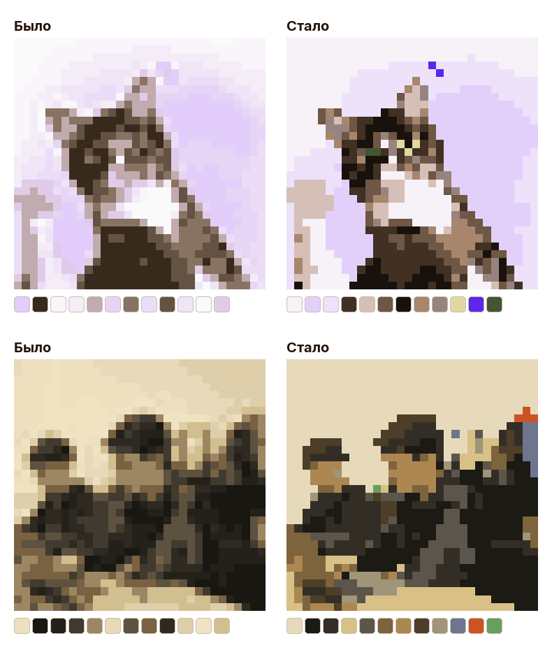

# Документация проекта «Пиксель-арт»

Материалы мастер-класса для школы программирования (11–17 лет): код, библиотека, приложение, две презентации и конспект.

## Содержание

1. [Структура проекта](#структура-проекта)
2. [Установка](#установка)
3. [Скрипт `main.py`](#скрипт-mainpy)
4. [Библиотека `pixelkid`](#библиотека-pixelkid)
5. [Приложение «Пиксель-раскраска»](#приложение-пиксель-раскраска)
6. [Презентации](#презентации)
7. [Публикация библиотеки на PyPI](#публикация-библиотеки-на-pypi)
8. [Частые проблемы](#частые-проблемы)

## Структура проекта

```
First_master_class/
├── main.py                  скрипт для детей (использует pixelkid)
├── requirements.txt         зависимости всего проекта
├── pixelkid/                библиотека (пакет для pip)
│   ├── pyproject.toml
│   ├── README.md            описание функции
│   ├── src/pixelkid/
│   │   ├── core.py          функция pixelate
│   │   ├── coloring.py      функция coloring_pdf (PDF-раскраска)
│   │   └── fonts/           шрифт Inter (лицензия OFL)
│   └── tests/
├── app/pixel_paint.py       приложение «Пиксель-раскраска» (PyQt6)
├── slides/
│   ├── presentation_shct.pdf         презентация в стиле ШЦТ
│   ├── presentation_mastersam.pdf    презентация в стиле МАСТЕРСАМ
│   ├── build_slides.py               сборка обеих презентаций
│   ├── make_assets.py                подготовка картинок
│   ├── make_app_shot.py              скриншот приложения
│   ├── source/                       исходные картинки для слайдов
│   └── assets/                       готовые картинки для слайдов
└── docs/
    ├── lesson_plan.md       конспект для преподавателя
    ├── lesson_plan.pdf
    └── DOCUMENTATION.md     этот файл
```

## Установка

Нужен Python 3.9 или новее.

```bash
cd First_master_class
python3 -m venv .venv
source .venv/bin/activate          # Windows: .venv\Scripts\activate
pip install -r requirements.txt
```

Это установит Pillow, PyQt6 и библиотеку `pixelkid` 0.2.0+ с PyPI (вместе с reportlab для PDF). Чтобы менять код библиотеки, поставьте её из папки проекта в режиме разработки: `pip install -e ./pixelkid` — изменения сразу видны.

**Mac и tkinter.** `main.py` использует окно выбора файла из `tkinter`. Если Python установлен через Homebrew, а запуск падает с `No module named '_tkinter'`, выполните `brew install python-tk@3.14` (версию замените на свою).

## Скрипт `main.py`

Простой скрипт, который дети запускают первым. Вся работа с картинкой — один вызов `pixelate` из библиотеки `pixelkid`:

1. Открывается окно выбора фото.
2. В терминале вводятся размер пикселя и число цветов.
3. `pixelate(...)` делает пиксель-арт и сохраняет его в `my_pixel_art.png` в текущей папке (откуда запущена программа).
4. `coloring_pdf(...)` сохраняет рядом `my_coloring.pdf` — раскраску по номерам (32 клетки в ширину, 12 цветов). Пиксель-арт открывается на экране.

```bash
python main.py
```

Окна `simpledialog` и `messagebox` из `tkinter` не используются: в Tk 9 на Mac они падают с ошибкой `MacWindowStyle`.

## Библиотека `pixelkid`

Подробно: [pixelkid/README.md](../pixelkid/README.md). Кратко:

```python
from pixelkid import pixelate, coloring_pdf
pixelate("photo.jpg", pixel_size=12, colors=16, save_as="art.png")
coloring_pdf("photo.jpg", save_as="coloring.pdf", cells=32, colors=12)
```

Как устроена `pixelate` (с версии 0.3.0):

1. Фото уменьшается до рабочей копии — до 6 × 6 точек на каждую будущую клетку.
2. Палитра подбирается методом k-means в цветовом пространстве Lab, начиная с самых непохожих цветов (нет почти одинаковых оттенков).
3. Каждая клетка получает самый частый цвет своих точек (голосование); редкие цвета получают бонус `RARE_BONUS = 0.2`, чтобы тонкие линии на границе клеток не пропадали.
4. Если какой-то цвет не победил ни в одной клетке, палитра подбирается чуть больше — в итоге цветов ровно столько, сколько просили.
5. Увеличение без размытия (`NEAREST`).



Замеры на 4 фото (пальма, кот, дети, градиент), в среднем по настройкам 24/8, 32/12, 48/16:

| | Старый (0.2.0) | Новый (0.3.0) |
|---|---|---|
| Минимальная разница цветов палитры, ΔE (больше — различимее) | 2.6–4.6, бывало 0.4 — цвета-дубли | 10.4–16.2 |
| Одиночные клетки («рябь», меньше — удобнее раскрашивать) | 10–14 % | 2.5–5 % |
| Отличие от оригинала, ΔE (меньше — точнее) | 5.6–7.9 | 6.2–7.6 |

Результат детерминирован (одна картинка — один результат), поэтому приложение и PDF-раскраска всегда совпадают. Большое фото 24 Мп обрабатывается за ~0.3 с (худший случай `pixel_size=2`, 256 цветов — ~1.4 с).

### PDF-раскраска (`coloring_pdf`)

Цветной PDF формата A4 в стиле МАСТЕРСАМ: логотип «М» (нарисован векторно по SVG с mastersam.org), оранжевый `#FF6A00`, шрифт Inter.

- **Страница 1 — раскраска:** сетка клеток, в каждой номер цвета; каждая 10-я линия оранжевая, чтобы легче считать; палитра «номер · квадратик цвета · RGB»; строка «Имя».
- **Страница 2 — ответ:** та же сетка, закрашенная цветами.

Ограничения для печати: `cells` от 4 до 60, `colors` от 2 до 24. Номер 1 — самый частый цвет, так же нумерует приложение. PDF строится библиотекой reportlab, шрифты Inter лежат в пакете (`pixelkid/src/pixelkid/fonts`, лицензия OFL).

**Тесты:**

```bash
pip install pytest
pytest pixelkid/tests
```

## Приложение «Пиксель-раскраска»

```bash
python app/pixel_paint.py              # потом кнопка «Открыть фото»
python app/pixel_paint.py photo.jpg    # сразу с фото
```

| Элемент | Что делает |
|---|---|
| Открыть фото | Выбор файла (PNG, JPG, WEBP) |
| Клеток в ширину | От 10 до 48. Больше клеток — детальнее, но дольше раскрашивать |
| Цветов | От 2 до 16. Каждому цвету — номер в палитре |
| Палитра | Клик по номеру выбирает цвет |
| Клик / зажатая мышь по клетке | Закрашивает клетку выбранным цветом (в пустых клетках виден правильный номер) |
| Показать подсказку (зажми) | Пока кнопка зажата, показывается правильная картинка |
| Закрасить всё | Автозаполнение |
| Сохранить | PNG: каждая клетка 20×20 пикселей, незакрашенные — белые |
| PDF-раскраска | PDF для печати через `coloring_pdf` с теми же клетками и цветами, что на экране: номера и палитра совпадают |

Приложение сделано как демонстрация: оно намеренно простое и нужно, чтобы показать, как функция `pixelate` становится частью программы с окнами. Вся логика в одном файле: класс `Canvas` (полотно) и `Window` (окно).

## Презентации

Две презентации с одинаковым содержанием (15 слайдов):

- `slides/presentation_shct.pdf` — стиль ШЦТ: фиолетово-синий градиент, шрифт Open Sans, логотип «Школа цифровых технологий».
- `slides/presentation_mastersam.pdf` — стиль МАСТЕРСАМ: оранжевый `#FF6A00`, шрифт Inter, логотип «М» с сайта mastersam.org.

**Пересборка** (если нужно поменять текст или фото):

```bash
pip install playwright pillow
playwright install chromium
python slides/make_assets.py        # картинки из slides/source
python slides/build_slides.py       # PDF
```

Тексты слайдов находятся в функциях `s_...` файла `slides/build_slides.py`, стили — в строке `CSS` в начале файла. Порядок слайдов задаёт список `SLIDES`. Для загрузки шрифтов нужен интернет.

**Слайд 9 (TikTok).** Реальные ролики в PDF не встроены: там макеты телефонов. Покажите свежие ролики с экрана или вставьте QR-коды.

## Публикация библиотеки на PyPI

Опубликованы версии **0.1.0** (`pixelate`) и **0.2.0** (`pixelate` + `coloring_pdf`): https://pypi.org/project/pixelkid/. Ниже шаги для публикации новых версий.

1. Зарегистрируйтесь на [pypi.org](https://pypi.org) и включите двухфакторную защиту.
2. Создайте API-токен: Account settings → API tokens.
3. Проверьте, что имя `pixelkid` свободно (на момент подготовки было свободно). Если занято — измените `name` в `pixelkid/pyproject.toml` и папку `src/pixelkid`.
4. Соберите и проверьте пакет:
   ```bash
   cd pixelkid
   pip install build twine
   python -m build
   twine check dist/*
   ```
5. Сначала загрузите на тестовый сервер [test.pypi.org](https://test.pypi.org):
   ```bash
   twine upload --repository testpypi dist/*
   ```
6. Если всё в порядке — на настоящий:
   ```bash
   twine upload dist/*
   ```
   Логин: `__token__`, пароль: ваш токен.

Опубликованную версию нельзя перезаписать: для исправлений увеличьте `version` в `pyproject.toml` и в `src/pixelkid/__init__.py`.

**Без PyPI.** Библиотеку можно раздавать файлом `.whl` (после `python -m build` он лежит в `pixelkid/dist/`): `pip install pixelkid-0.2.0-py3-none-any.whl`. Или установить прямо из папки: `pip install ./pixelkid`.

## Частые проблемы

| Ошибка | Решение |
|---|---|
| `No module named 'PIL'` | `pip install pillow` |
| `No module named 'pixelkid'` | `pip install pixelkid` (или из папки проекта: `pip install ./pixelkid`) |
| `cannot import name 'coloring_pdf'` | Установлена старая версия 0.1.0: `pip install -U pixelkid` |
| `No module named 'reportlab'` | `pip install reportlab` (или переустановить `pixelkid`) |
| `No module named '_tkinter'` | Mac: `brew install python-tk@3.14`. Linux: `sudo apt install python3-tk` |
| `externally-managed-environment` | Работайте в виртуальном окружении (`python3 -m venv .venv`) |
| `ValueError: pixel_size должен быть 2 или больше` | Размер пикселя должен быть числом от 2 |
| Приложение не открывается на Linux | `pip install PyQt6` и пакеты Qt: `sudo apt install libxcb-cursor0` |
